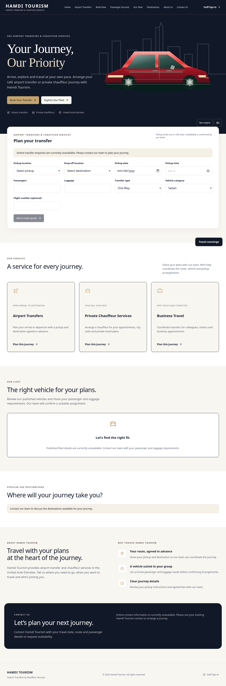

# Website preview

Captured from the actual production build. Supabase is not configured in these screenshots, so quotes, contact information and owner-managed fleet/destination records correctly show unavailable or empty states. These screenshots do not demonstrate live authentication, email delivery or uploads. Real owner uploads replace the illustrative hero and fill the fleet/destination image cards once published.

## Desktop

## Mobile

The current screenshots show Midnight Luxury with an original red coupe-SUV illustration and synthesized V8-style sound controls. The illustration is not a fleet listing or authentic BMW photograph/recording. Browser checks capture the actual running isolated build; no hosted accounts or bookings are created. Both files were decoded as valid PNGs.

For an actual browser preview in your existing Codespace, pull the feature branch without overwriting local changes, keep your secrets in the ignored environment settings, run `npm ci` and `npm run dev`, then use **Ports → 3000 → Open in Browser**. Keep the forwarded port private. Configure that exact HTTPS preview origin for Auth redirects before testing real accounts. A static PNG does not verify the backend. No production or public deployment has been performed.
